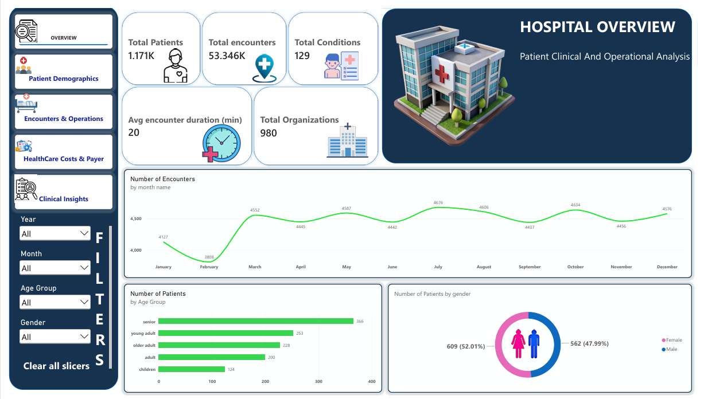
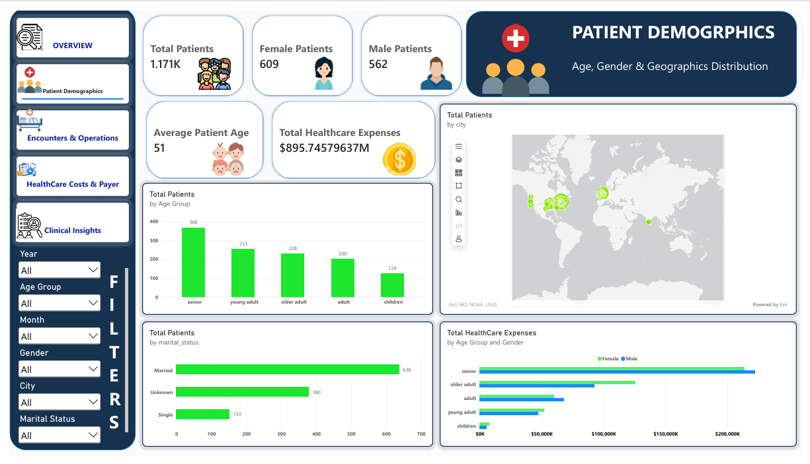
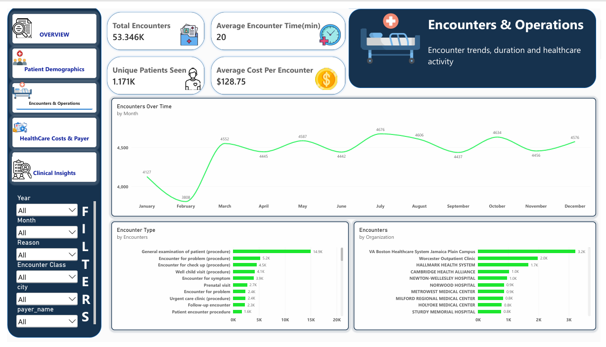
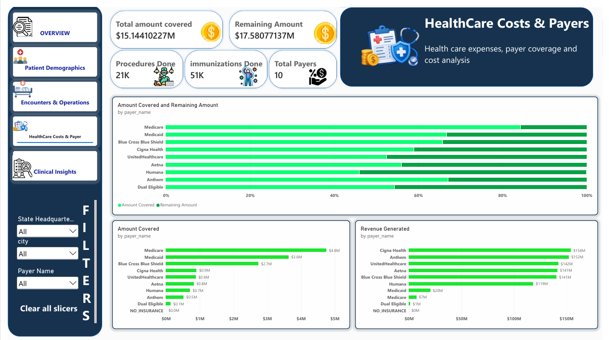
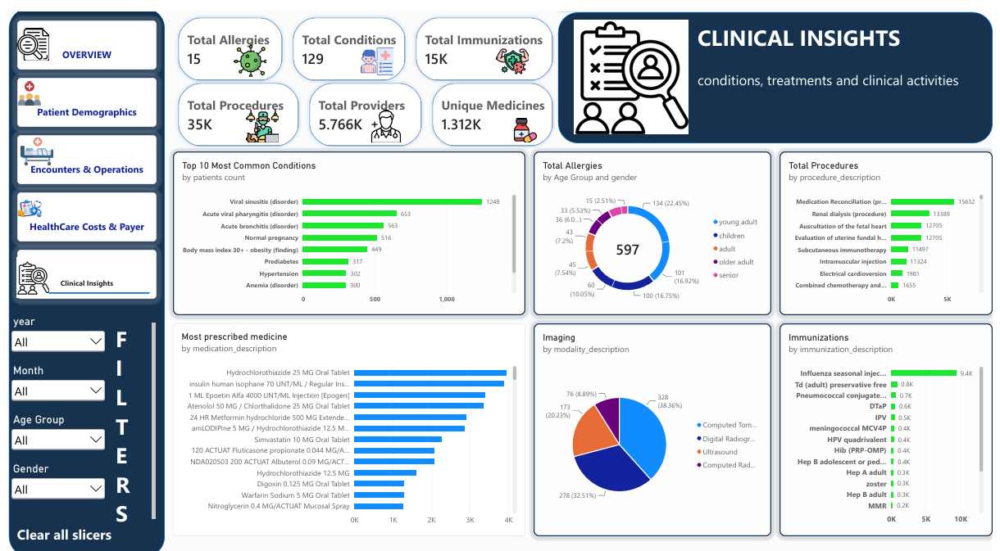

# 🏥 Hospital Analytics Project

An end-to-end **Hospital Data Analytics Project** using **Python, MySQL, and Power BI**. This project demonstrates how healthcare data can be cleaned, transformed, stored, analyzed, and presented through interactive dashboards.

The project uses synthetic healthcare data from **Synthea** and follows a complete data analytics workflow, from raw data preparation to dashboard development.

## 📌 Project Overview

The objective of this project is to analyze hospital-related data and develop insights into patient demographics, hospital encounters, healthcare costs, payer coverage, and clinical activities.

The project follows this workflow:

**Raw Data → Python ETL → MySQL Database → SQL Analysis → Power BI Dashboard**

## 🎯 Project Objectives

- Clean and prepare raw healthcare datasets.
- Handle missing values, duplicates, and data inconsistencies.
- Build a relational MySQL database using primary and foreign keys.
- Perform basic and advanced SQL analysis.
- Develop an interactive Power BI dashboard.
- Present key metrics and trends through meaningful visualizations.

## 🛠️ Tools & Technologies

| Tool | Purpose |
|---|---|
| Python | Data cleaning and transformation |
| Pandas | Data manipulation and ETL |
| Jupyter Notebook | Python development and documentation |
| MySQL | Database creation, storage, and querying |
| SQL | Data analysis |
| Power BI | Interactive dashboards and visualizations |

## 📂 Repository Structure

```text
Hospital-Analytics-Project/
│
├── Raw_Data/
│   ├── README.md
│   └── dataset_source_link.txt
│
├── Python_ETL/
│   └── Hospital_Data_Cleaning.ipynb
│   |__  readme.md
|
├── SQL_Analysis/
│   ├── 01_Schema_creation.sql
│   ├── 02_Analysis.sql
│   └── 05_Advanced_Analysis.sql
│   |__  readme.md
│
├── PowerBI_Dashboard/
│   ├── Hospital_Analytics.pbix
│   └── Hospital_Analytics.pdf
│   |__  readme.md
│
├── Dashboard_Previews/
│   ├── Page_1_Hospital_Overview.png
│   ├── Page_2_Patient_Demographics.png
│   ├── Page_3_Encounters_Operations.png
│   ├── Page_4_Healthcare_Costs_Payers.png
│   └── Page_5_Clinical_Insights.png
│   |__  readme.md
│
└── README.md
```

## 🔄 Project Workflow

### 1. Data Collection

- Used synthetic healthcare data generated through Synthea.
- Worked with multiple healthcare datasets, including patients, encounters, conditions, observations, medications, procedures, providers, organizations, and payers.

### 2. Data Cleaning & ETL Using Python

Used Python and Pandas to prepare the raw datasets.

Key activities:
- Standardized column names.
- Checked and handled missing values.
- Identified duplicate records.
- Corrected data types.
- Prepared datasets for database loading.
- Exported cleaned data for further analysis.

### 3. Database Development Using MySQL

- Created the `hospital_analytics` database.
- Designed relational tables.
- Defined primary keys and foreign key relationships.
- Loaded the cleaned datasets into MySQL.
- Organized data for structured querying and analysis.

### 4. SQL Analysis

Performed basic and advanced SQL analysis to explore healthcare data.

Topics used include:
- Filtering and sorting.
- Aggregate functions.
- GROUP BY and HAVING.
- Joins.
- Subqueries and CTEs.
- Window functions.
- Date-based analysis.

### 5. Power BI Dashboard Development

Developed a five-page interactive dashboard to explore different aspects of hospital operations and healthcare data.

## 📊 Dashboard Pages

### Page 1 — Hospital Overview

Provides a high-level summary of hospital data.

Key metrics and analysis:
- Total patients.
- Total encounters.
- Average encounter duration.
- Total conditions.
- Encounter trends over time.
- Patient distribution by age group and gender.

### Page 2 — Patient Demographics

Explores patient characteristics and demographic distribution.

Key analysis:
- Total patients.
- Average patient age.
- Female and male patient distribution.
- Age-group distribution.
- Patient distribution by location.
- Marital status and healthcare expense analysis.

### Page 3 — Encounters & Operations

Focuses on hospital encounters and operational activity.

Key analysis:
- Total encounters.
- Unique patients visited.
- Average encounter duration.
- Average cost per encounter.
- Encounters over time.
- Encounters by type and organization.
- Encounter duration by type.

### Page 4 — Healthcare Costs & Payers

Explores healthcare expenses and payer-related coverage.

Key analysis:
- Total healthcare expenses.
- Total amount covered.
- Remaining healthcare expenses.
- Average cost per encounter.
- Payer-related analysis.
- Expenses and coverage comparisons.

### Page 5 — Clinical Insights

Provides an overview of clinical records and healthcare activities.

Key analysis:
- Total conditions.
- Total allergies.
- Total procedures.
- Total immunizations.
- Common conditions.
- Conditions by age group.
- Procedures by description.
- Immunizations by vaccine type.
- Imaging studies by modality.

## 🖼️ Dashboard Preview

### Hospital Overview


### Patient Demographics


### Encounters & Operations


### Healthcare Costs & Payers


### Clinical Insights


## ⚙️ How to Run the Project

1. Download or clone this repository.
2. Obtain the original synthetic dataset using the source information in `01_Raw_Data/`.
3. Open the Jupyter Notebook in `02_Python_ETL/` and execute the data-cleaning workflow.
4. Set up MySQL and execute the SQL scripts in `03_SQL_Analysis/` in the appropriate order.
5. Open the Power BI `.pbix` file.
6. Configure the data source connection if required and refresh the data to explore the dashboard.

## 📚 Dataset & Disclaimer

This project uses **synthetic healthcare data generated by Synthea** for learning and analytical purposes.

The data does not represent actual patients, real hospital records, or real-world medical outcomes. The analysis is intended for educational and portfolio demonstration purposes only.

**Dataset Source:** [Synthea – Synthetic Patient Population Simulator](https://synthetichealth.github.io/synthea/)

## 🚀 Key Learning Outcomes

Through this project, I gained practical experience in:

- End-to-end data analytics workflow.
- Data cleaning and transformation using Python.
- Relational database design and MySQL.
- Writing SQL queries for analytical purposes.
- Developing interactive dashboards in Power BI.
- Creating meaningful KPIs and data visualizations.
- Working with multiple related datasets.

## 👨‍💻 Author

**Pankaj Juyal**

B.Tech Graduate | Fresher Data Analyst

**Skills:** Python | Pandas | MySQL | SQL | Power BI | Data Analysis

---

⭐ If you find this project useful, feel free to explore the repository and share your feedback.
